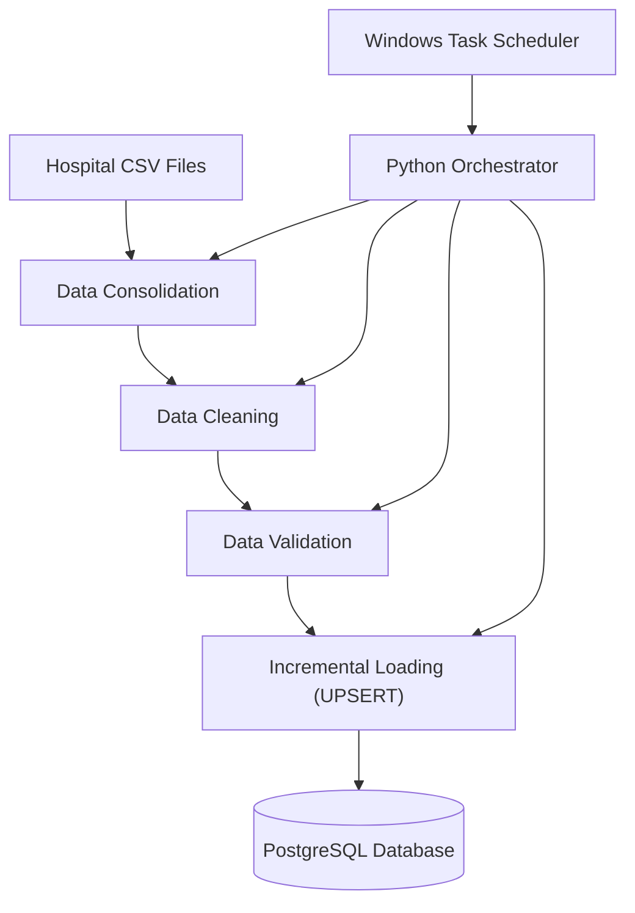

# Hospital Data Engineering ETL Pipeline

An end-to-end data engineering project designed to automate the extraction, transformation, validation, and loading (ETL) of hospital data using Python and PostgreSQL.

This project demonstrates a complete ETL workflow, including data quality checks, incremental loading (UPSERT), error handling, logging, and task scheduling.

## Project Overview

The pipeline consolidates data from multiple hospital CSV files, cleans and validates records, and loads the resulting data into a PostgreSQL database.

## ETL Architecture

The following diagram illustrates the end-to-end data pipeline, from synthetic hospital CSV files to the PostgreSQL data warehouse.



## Tech Stack

<h2 align="center">Technologies</h2>

<p align="center">
  
</p>

<p align="center">
  
  
  
</p>

## Key Features

- **Data Generation:** Creates synthetic hospital datasets for testing.
- **Data Consolidation:** Combines CSV files from multiple hospitals into a unified dataset.
- **Data Cleaning:** Removes incomplete and duplicate records.
- **Data Validation:** Applies business rules to ensure data quality.
- **Incremental Loading:** Uses PostgreSQL UPSERT to insert new records and update existing ones.
- **Database Integration:** Connects Python to PostgreSQL using SQLAlchemy.
- **Logging and Error Handling:** Records pipeline execution details and errors.
- **Automation:** Executes the ETL pipeline automatically using Windows Task Scheduler.

## Project Structure

```text
proyecto-python-data-engineering/
│
├── data/
│   ├── raw/                 # Original hospital CSV files
│   ├── processed/           # Cleaned and validated datasets
│   └── rejected/            # Records rejected during processing
│
├── logs/                    # Pipeline execution logs
├── src/                     # Python ETL scripts
│
├── .env                     # Local database credentials (not tracked by Git)
├── .gitignore               # Files excluded from Git
├── ejecutar_pipeline.bat    # Windows pipeline execution script
└── README.md                # Project documentation
```

**Note:** The `data/` and `logs/` directories are generated locally and excluded from Git. The `.env` file must be created locally and is also excluded from Git.

## Installation and Setup

### 1. Clone the repository

```bash
git clone https://github.com/CarlosRaulArdila/proyecto-python-data-engineering.git
cd proyecto-python-data-engineering
```

### 2. Create and activate the Python environment

```bash
conda create -n data_engineering python=3.12
conda activate data_engineering
```

### 3. Install dependencies

```bash
pip install pandas sqlalchemy psycopg2-binary python-dotenv
```

### 4. Configure PostgreSQL

Make sure PostgreSQL is running and create a database named `hospital_dw`.

Create a `.env` file in the project root directory with your database credentials:

```env
DB_HOST=localhost
DB_PORT=5433
DB_NAME=hospital_dw
DB_USER=your_username
DB_PASSWORD=your_password
```

Replace the example values with your own PostgreSQL credentials.

### 5. Generate the synthetic datasets

```bash
python src/generar_datos.py
```

This creates the sample hospital CSV files required by the pipeline.

### 6. Create the database table

```bash
python src/crear_tabla.py
```

### 7. Run the ETL pipeline

```bash
python src/ejecutar_pipeline.py
```

**Note:** PostgreSQL must be running, the `hospital_dw` database must exist, and the `.env` file must contain valid connection settings before executing the pipeline.

## Pipeline Execution

The ETL pipeline executes the following steps:

1. Consolidates data from three hospital CSV files.
2. Cleans incomplete and duplicate records.
3. Validates data using predefined business rules.
4. Loads validated records into PostgreSQL using incremental UPSERT operations.

### Execution Results

| Metric | Result |
|---|---:|
| Source hospitals | 3 |
| Initial records | 15 |
| Incomplete records rejected | 2 |
| Duplicate records removed | 1 |
| Validated records | 12 |
| Validation errors | 0 |
| Database operations on repeated execution | 0 |

The pipeline is designed to be idempotent: running it again without new or modified source data does not create duplicate records or unnecessary updates.

## Future Improvements

- **Automated Testing:** Implement unit and integration tests using Pytest.
- **Advanced Orchestration:** Integrate Apache Airflow to manage and monitor ETL workflows.
- **Cloud Integration:** Deploy the data pipeline to a cloud platform.
- **Data Monitoring:** Implement data quality metrics and pipeline performance monitoring.
- **Containerization:** Dockerize the ETL application for easier deployment and portability.